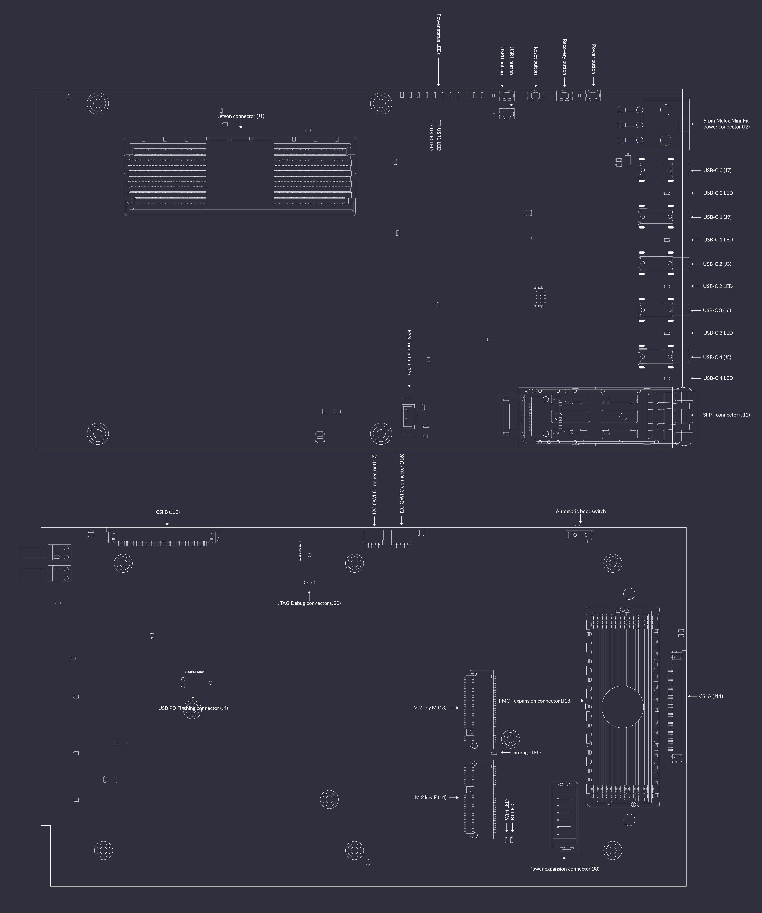
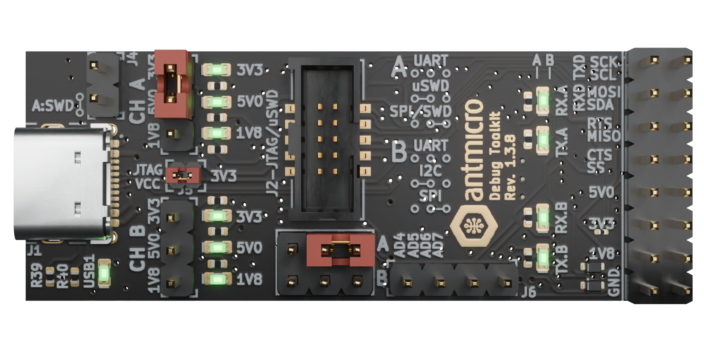
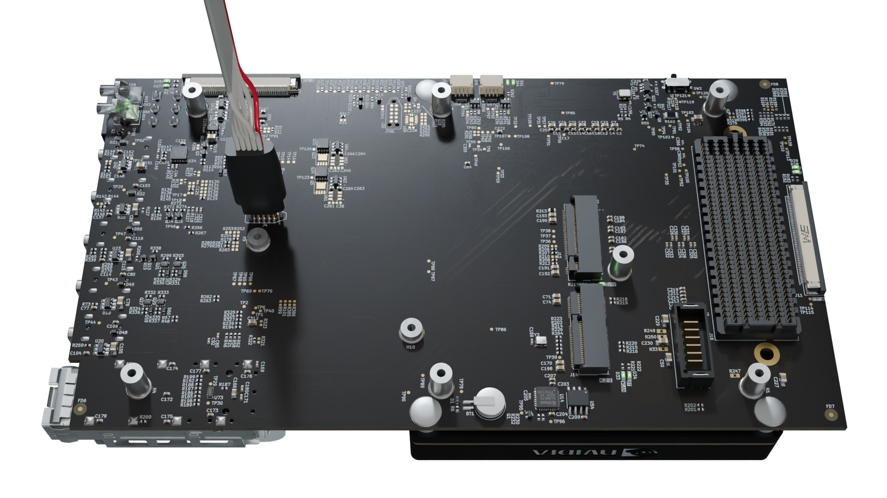

# Board overview

Jetson AGX Thor Baseboard is an open hardware board design supporting the NVIDIA Jetson AGX Thor T5000 SoM.
The board design files were created in KiCad 9.x. and are available in this GitHub [repository](https://github.com/antmicro/jetson-agx-thor-baseboard).
The board is a versatile development kit which can be adopted for standalone, desktop usage but it can be also integrated into a bigger computing system. It features a range of typical IO interfaces and offers compatibility with camera modules and video accessories developed by Antmicro. This makes it possible to use it for developing advanced vision systems, robots, autonomous vehicles and many more.  

You can find out more about the Jetson AGX Thor Baseboard in this [blog article](https://antmicro.com/blog/2025/10/open-hardware-jetson-agx-thor-baseboard), or by visiting Antmicro's portals listed below:
* [Open Hardware Portal](https://openhardware.antmicro.com/boards/jetson-agx-thor-baseboard/)
* [System Designer](https://designer.antmicro.com/library/devices/jetson-agx-thor-baseboard)

They provide 3D renders and the board stackup definition, as well as an interactive preview of the board schematic.

## IO map

A map of on-board connectors, status LEDs, control buttons and I/O interfaces is provided below.  

:::{figure-md}


Jetson AGX Thor Baseboard interface map
:::

## Power

The Jetson AGX Thor Baseboard can be powered with a stable 24V DC voltage via the on-board 6-pin Molex Mini-Fit locking connector ([`J2`](#J2)). 
Recommended power supply to mate with the 6-pin Molex Mini-Fit connector ([`J2`](#J2)) is the [MeanWell/GST360B24-C6P(24V/360W)](https://www.tme.eu/Document/7fa982c5fc04a55e4bde3e7ea1a6b4ec/GST360B-spec.pdf).

Power consumption of the device varies depending on the utilized peripherals and specific application.
We suggest to use a power supply capable of providing at 130 W for basic functionality.
The estimated maximal power required from the source when using both USB PD lines reaches around 450 W.

### USB-C Power Delivery

* USB Power Delivery PD is available on two USB-C ports, each capable of sourcing 100W:
    * USB-C0 ([`J7`](#J7)) debug console interface port
    * USB-C1 ([`J9`](#J9)) 

Those ports are maintained by the on-board USB-C Power Delivery controller (Texas Instruments/[TPS65988](https://www.ti.com/product/TPS65988/part-details/TPS65988DHRSHR)).
This controller needs to be configured in order to make it implement one of the desired power negotiation scenarios.

## USB-C Power Delivery controller configuration

The on-board USB-C Power Delivery controller (Texas Instruments/[TPS65988](https://www.ti.com/product/TPS65988/part-details/TPS65988DHRSHR)) can be configured for a specific power profile by writing a binary configuration file to an SPI flash.
You can generate your own configuration file with the [TPS6598X-CONFIG](https://www.ti.com/tool/TPS6598X-CONFIG) utility provided by Texas Instruments.
Please refer to the Jetson AGX Thor Baseboard [schematics](https://github.com/antmicro/jetson-agx-thor/blob/main/doc/jetson-agx-thor-baseboard-schematic.pdf) to identify the USB port and power supply rail associated with it to generate a valid power profile setting while using the `TPS6598X-CONFIG` tool.
Also please refer to the [TPS65987DDH and TPS65988DH Host Interface Technical Reference Manual](https://www.ti.com/lit/ug/slvubh2b/slvubh2b.pdf) for further details.

There are several ways to write the USB-C PD configuration to the on-board controller:
* Via an external SPI Flash programmer connected to the [`J4`](#J4)
* [Flashing from the debug console interface port](#tps65988-config-tool-via-the-debug-console-interface-port)

### External SPI Flash programmer
#### 1. Collect the hardware

You will need the following pieces of hardware to proceed with writing the USB-C PD configuration file to the SPI Flash:

* A computer running Linux 
* USB dongle based on FTDI/(FT4232H-56Q) [FTDI4232](https://ftdichip.com/products/ft4232hq/).
  We suggest using Antmicro's open hardware [Debug Toolkit](https://github.com/antmicro/ftdi-toolkit) to simplify the setup (the cable mentioned below connects its J2 straight with Jetson AGX Thor Baseboard's J4)
* 10 Pin Tag-Connect [TC2050-IDC-NL](https://www.tag-connect.com/product/tc2050-idc-nl-10-pin-no-legs-cable-with-ribbon-connector) cable
  This cable should be connected to the signals from FTDI FT4232 according to the following table:

| Tag-Connect TC2050-IDC-NL-050 [(pinout)](https://www.tag-connect.com/wp-content/uploads/bsk-pdf-manager/TC2050-IDC-NL_Datasheet_8.pdf) | FTDI 4232 [(pinout)](https://ftdichip.com/wp-content/uploads/2024/05/DS_FT4232H.pdf)  |
|----------------------------------------------------------------------------------------------------------------------------------------|---------------------------------------------------------------------------------------|
| 1                                                                                                                                      | 3V3                                                                                   |
| 2                                                                                                                                      | ADBUS3 (TMS/CS)                                                                       |
| 3                                                                                                                                      | GND                                                                                   |
| 4                                                                                                                                      | ADBUS0 (TCK/SCLK)                                                                     |
| 5                                                                                                                                      | GND                                                                                   |
| 6                                                                                                                                      | ADBUS2(TDO/MISO)                                                                      |
| 7                                                                                                                                      | NC                                                                                    |
| 8                                                                                                                                      | ADBUS1 (TDI/MOSI)                                                                     |
| 9                                                                                                                                      | GND                                                                                   |
| 10                                                                                                                                     | NC                                                                                    |

#### 2. Prepare the FT4232 dongle

  *  Set the [Debug Toolkit](https://github.com/antmicro/ftdi-toolkit) Channel A to 3.3V logic with a jumper.
  *  Enable JTAG VCC with a jumper.
  *  Select `SPI/SWD` interface mode for channel A with a jumper.
  *  Connect the 10 Pin Tag-Connect cable to the Debug Toolkit assuming the connection mapping specified in the table above (for Antmicro Debug Toolkit - connect to J2 connector).
  
:::{figure-md}


Debug Toolkit Jumper configuration for writing the USB-C PD configuration file.
:::
 
#### 3. Prepare the PC for flashing

  * Install the [flashrom](https://github.com/flashrom/flashrom) utility on your host PC.
    On Debian-based distributions you can use a package manager for that.
```
sudo apt install flashrom
```
  * Adjust the size of the TPS6598 binary configuration file (we named it `config.bin`) to match the SPI flash size:
```
truncate -s 1048576 config.bin
```

#### 4. Write the configuration

  * Connect [Tag-Connect Plug-of-Nails](https://www.tag-connect.com/product/tc2050-idc-nl-050) to the [`J4`](#J4) connector on the Jetson AGX Thor Baseboard.
   Hold the plug in place firmly during the flashing process.
   The SPI flash will be powered via the programming cable during the flashing process - you do not have to provide your Jetson AGX Thor Baseboard with power.
   
:::{figure-md}


Jetson AGX Thor Baseboard with Tag-Connect plugged for PD controller flashing.
:::
   
 * Check if SPI Flash can be detected via Debug Toolkit:
```
flashrom -p ft2232_spi:type=4232H,port=A,divisor=64 | grep "W25Q80.V"
```
Expected outcome:
```
Found Winbond flash chip "W25Q80.V" (1024 kB, SPI) on ft2232_spi.
```

 * Write the configuration file to the SPI Flash:
```
flashrom -p ft2232_spi:type=4232H,port=A,divisor=64 -w config.bin
```
Expected outcome:
```
(...)
Reading old flash chip contents... done.
Erasing and writing flash chip... Erase/write done.
Verifying flash... VERIFIED.
```

 * You can repeat the previous command to ensure that the binary file has been written successfully:

Expected outcome:
```
(...)
Warning: Chip content is identical to the requested image.
Erase/write done.
```

```{important}
The section below uses scripts originally designed for the Jetson Orin Baseboard, hence the difference in the repository and file names. The Jetson Orin Baseboard uses the same TPS65988 USB PD Controller and SPI Flash memory as the Jetson AGX Thor, that's why they can be also used for this board. 
```

### TPS65988-config tool from Jetson AGX Thor user space

The TPS65988-config flashing script can be found in the [antmicro-jetson-orin-baseboard-tps65988-config](https://github.com/antmicro/antmicro-jetson-orin-baseboard-tps65988-config) repository.

#### 1. Prepare hardware

To properly execute this script, boot the Jetson AGX Thor Baseboard, and connect to it via the [debug console](getting_started.md#connect-the-debug-console) or via SSH. 
Internet connection is also suggested.

#### 2. Install dependencies
Log into the Jetson Thor module.
Clone the [antmicro-jetson-orin-baseboard-tps65988](https://github.com/antmicro/antmicro-jetson-orin-baseboard-tps65988-config) repository and install the `smbus2` package using `pip`

```
git clone https://github.com/antmicro/antmicro-jetson-orin-baseboard-tps65988-config.git
pip3 install smbus2
cd antmicro-jetson-orin-baseboard-tps65988-config
```

#### 3. Flash the config
Run:

```
python3 TPS65988_flash.py --erase --write JOBrev1_1_6.bin
```

Expected outcome:
```
(...)
Writing 42KB to flash memory...
Write completed 43968 bytes written
The PD Controller has been flashed successfully
Performing cold reset
```

```{important}
The section below uses scripts originally designed for the Jetson Orin Baseboard, hence the difference in the repository and file names. The Jetson Orin Baseboard uses the same TPS65988 USB PD Controller and SPI Flash memory as the Jetson AGX Thor, that's why they can be also used for this board. 
```

### TPS65988-config tool via the debug console interface port
This option allows for flashing the USB-C Power Delivery controller without SoM or external power.

#### 1. Prepare hardware
* Disconnect power supply from the baseboard
* Remove Jetson module from the baseboard
* Connect a host PC to Jetson AGX Thor Baseboard USB-C Debug Connector ([`J7`](#J7))

#### 2. Install dependencies

On the host PC:

Clone the [antmicro-jetson-orin-baseboard-tps65988-config](https://github.com/antmicro/antmicro-jetson-orin-baseboard-tps65988-config) repository and install the `smbus2` package with `pip`

```
git clone https://github.com/antmicro/antmicro-jetson-orin-baseboard-tps65988-config.git
pip3 install smbus2
cd antmicro-jetson-orin-baseboard-tps65988-config
```

#### 3. Write the configuration
```
python3 TPS65988_flash.py --erase --write ./JOBrev1_1_6.bin --ft230x
```
During the flashing process the [`D21`](#D21) LED should light up.

Expected outcome:
```
(...)
Writing 42KB to flash memory...
Write completed 43968 bytes written
The PD Controller has been flashed successfully
Performing cold reset
Reverting FT230X to UART configuration
```
The [`D21`](#D21) RX LED should turn off indicating end of communication.

## Mechanics

The Jetson AGX Thor Baseboard PCB is 180x100 millimeters (WxL) which translates into 7.09x3.94 inch. The overall height of the set depends on the cooling module attached. The base setup with the integrated thermal transfer plate (TTP) without a cooling module is 29 mm or 1.14 inch tall. The KiCad PCB design files include mechanical layers with dimensions specified for the fastening holes and notable components. 


