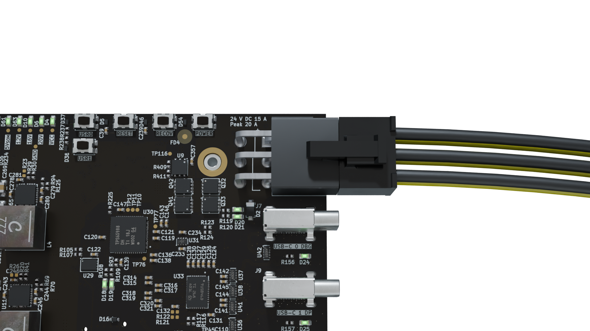
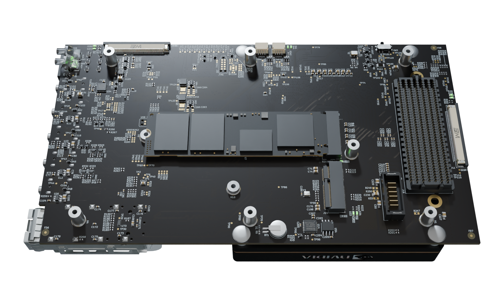
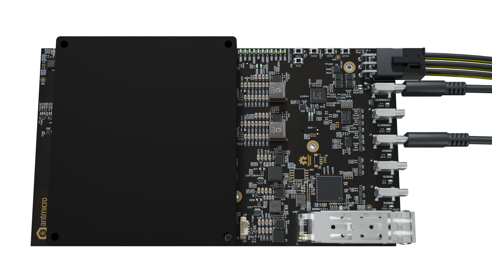

# Getting started guide

This manual will guide you through the initial setup of the open hardware [Jetson AGX Thor Baseboard](https://github.com/antmicro/jetson-agx-thor-baseboard).
It describes the basic steps required to assemble the board with required peripheral accessories, write a compiled Board Support Package (BSP) to the processing module and get it booted.
If you want to learn more about the Jetson AGX Thor Baseboard itself, go to the [Board Overview](./board_overview.md) section.
That section also includes an [I/O map](./board_overview.md#io-map) that may come in handy when locating interface connectors mentioned in this guide.

## Collect the hardware

To get started with the Jetson AGX Thor Baseboard, you'll need the following hardware:

### 1. Jetson SoM

The Jetson AGX Thor Baseboard targets the [Jetson AGX Thor T5000 SoM](https://www.nvidia.com/en-us/autonomous-machines/embedded-systems/jetson-thor/).

### 2. Power supply

The Jetson AGX Thor Baseboard should be powered through a 6-pin Molex Mini-Fit locking connector ([`J2`](#J2)). The input voltage is 24 VDC and must not exceed that value to prevent damage to the onboard DC-DC converters and module itself.

Recommended power supply to mate with the 6-pin Molex Mini-Fit connector ([`J2`](#J2)) is the [MeanWell/GST360B24-C6P(24V/360W)](https://www.tme.eu/Document/7fa982c5fc04a55e4bde3e7ea1a6b4ec/GST360B-spec.pdf).

Power consumption of the device varies depending on the utilized peripherals and specific application.  
We suggest to use a power supply capable of providing at 130 W for basic functionality.   
The estimated maximal power required from the source when using both USB PD lines reaches around 450 W.
:::{figure-md}


Jetson AGX Thor Baseboard DC power connection with polarity marking (yellow - bottom row: VCC, black - top row: GND).
:::
### 3. Storage

You should equip the Jetson AGX Thor Baseboard with M.2 NVMe SSD storage with at least 64GB of capacity.
That will be the primary storage device from which the SoM will boot.

### 4. Cooling 

Antmicro designed a dedicated [enclosure](https://github.com/antmicro/jetson-agx-thor-baseboard-enclosure) for the Jetson AGX Thor. The project contains files for CNC milling both the aluminum enclosure and a copper heatsink that together with two blower fans allow for efficient cooling of the SoM.  
Alternative commercial cooling solutions for the Jetson AGX Thor SoM are [ATS-NVP-3739-C1-R0](https://www.qats.com/Product/Heat-Sinks/BGA-Heat-Sink---High-Performance/Device-Specific---NVIDIA/ATS-NVP-3739-C1-R0/3692.aspx) and [ATS-NVA-3740-C1-R0](https://www.qats.com/Product/Heat-Sinks/BGA-Heat-Sink---High-Performance/Device-Specific---NVIDIA/ATS-NVA-3740-C1-R0/3693.aspx) for low to medium power applications and [ATS-NVA-3752-C2-R0](https://www.qats.com/Product/Heat-Sinks/BGA-Heat-Sink---High-Performance/Device-Specific---NVIDIA/ATS-NVA-3752-C2-R0/3694.aspx) for running at full power. 
:::{caution}
Using the SoM without any cooling solution attached will make it throttle and eventually reboot or crash the system due to overheating.
:::
### 5. Fastening bolts

You will need at least one metric M2.5 (5mm long) bolt and a matching screwdriver to fasten the SSD to the baseboard.
You may want to use more bolts to fasten the SoM and the baseboard to the baseplate.
The SoM is fastened to the baseboard using four bolts with metric M3 thread (ISO 7045). All other mechanical fastening points located on the board support bolts with metric M2.5 thread (ISO 7045).

### 6. Host PC

You will need a computer running Linux for flashing the reference BSP image to the Jetson AGX Thor SoM installed in the baseboard.
The BSP flashing instructions provided below were verified with Debian based systems.
You may need to introduce adjustments for other Linux distros.

### 7. Cabling

#### SoM Flashing and debug console

You will need two USB-C cables for connecting the SoM flashing port and the debug port located on the Jetson AGX Thor Baseboard to your PC.
You should avoid using USB hubs for the flashing interface to get the optimal flashing speed/performance.

#### Video output

Video output is optional.\
USB-C 1 port ([`J9`](#J9)) supports DisplayPort alternative mode and is the main way of obtaining video output. 
Additionally, the expansion connector ([`J18`](#J18)) `ASP-218650-01` compatible with the [FMC+ standard](https://suddendocs.samtec.com/notesandwhitepapers/samtec-vita574fmcplus-extender-application-note.pdf) exposes 3 DisplayPort interfaces. For more information regarding expansion connector pinout plese check [mappings](mappings.md#expansion-connector-pinout).

## Build your setup

To prepare the Jetson AGX Thor Baseboard for initial usage, follow the steps described below:

### 1. Install the cooling module

### 2. Install the SoM

Securely attach the NVIDIA Jetson AGX Thor SoM to the [`J1`](#J1) connector of the Jetson AGX Thor Baseboard.
Remember to connect the cooling fan plug into the [`J15`](#J15) fan receptacle.
You can fasten the SoM to the baseboard with four metric M3 bolts.

:::{caution}
The baseboard does not support hot-swapping of the SoM. 
Please disconnect all power sources from the baseboard and wait minimum 10s before removing/inserting the SoM.
:::

### 3. Install the storage

Install the NVMe M.2 SSD storage in the [`J13`](#J13) M.2 (key-M) slot located on the bottom side (i.e opposite side to the SoM) of the Jetson AGX Thor Baseboard.
You need to fasten the SSD with one metric M2.5 (5mm long) bolt to ensure reliable connection.

:::{figure-md}


Jetson AGX Thor Baseboard with the NVMe ready to be screwed down. 
:::

### 4. Apply power supply

Apply power to the board with the help of a power supply that meets the requirements described in the [Power supply](#power-supply) section.
Providing valid power supply should cause the VCC ([`D4`](#D4)) power indicator LED to light up.

### 5. Connect the debug console

Connect the debug USB-C 0 ([`J7`](#J7)) port to your PC.
This should cause the [`D24`](#D24) LED indicator located next to the USB port to light up and a virtual USB/serial port to get registered in your system under ``/dev/ttyUSBx``.
You can check the ``lsusb`` or ``dmesg`` commands to verify if the serial bridge was enumerated properly.

### 6. Connect the flashing interface

Connect the flashing USB-C 2 ([`J3`](#J3)) port to your PC.
This should cause the [`D51`](#D51) LED indicator located next to the USB port to light up.
Now you are ready to prepare the BSP flashing image and initialize the flashing process.

:::{figure-md}


Jetson AGX Thor Baseboard ready for flashing (with cooling module not pictured for clarity). 
:::

## Flash the BSP image

Jetson AGX Thor Baseboard comes with a reference Linux for Tegra BSP with kernel, DTB and modules. 
This BSP will let you verify the basic functionality of the board.
The following steps will guide you through the process of downloading and flashing a precompiled Board Support Package (BSP) for the Jetson AGX Thor Baseboard.

### 1. Get the BSP image

First, create a workspace directory that will contain all of the files you will need for flashing:

```bash
export WORK="$HOME/antmicro-agx-thor-bsp"
mkdir -p $WORK
cd $WORK
```
```{important}
Make sure the `$WORK` directory will be located on an `ext4` partition. Otherwise unpacking the `rootfs` will result in the loss of all valid permissions.
```
```{important}
Make sure you have enough free space on your disk - It is recommended to have at least 100 GB of free space.
```

Download the BSP image into the previously created workspace directory.
Make sure there is no other BSP image already downloaded there.

Next, unpack the BSP image:

```{important}
Make sure to unpack it *as root* with the -p flag (preserve permissions)
```

```bash
cd $WORK
sudo tar -xvpf Linux_for_Tegra.tar.gz
ls -l
```
```{note}
Unpacked directory should have following permissions:  
drwxrwxrwx 10 root root 4096 Mar 23 17:49 Linux_for_Tegra
```

### 2. Install dependencies

On a Debian-like system, you can install the flash tool dependencies via:

```bash
cd $WORK/Linux_for_Tegra
sudo ./tools/l4t_flash_prerequisites.sh
```
:::{important}
If you are not using Debian-like OS make sure that ping6 is executable in your shell.
NVidia toolchain uses this binary to ping Jetson and make sure that it is connected.
If ping6 is not available in your native package manager you can create a simple executable called ping6 and add it to your $PATH.
The content of the executable should be:
```bash
#!/bin/sh
ping -6 "$@"
```
After that make sure that the file is set as executable by running:
```bash
sudo chmod +x <path_to_ping6>
```
:::

### 3. Disable auto-mounting

When running a Debian-like operating system, you might encounter some difficulties with flashing the board, due to problems with disk auto-mounting.
A simple workaround for this issue is to disable auto-mounting for the time being:

```bash
gsettings set org.gnome.desktop.media-handling automount false
gsettings set org.gnome.desktop.media-handling automount-open false
```

### 4. Open debug console

Whenever developing with the Jetson AGX Thor Baseboard, it always makes sense to have a terminal hooked to the Debug UART on your host PC.
You can use any serial port terminal emulator for that, but we’ll use ``picocom`` in this guide.
Make sure that the [debug console USB](#connect-the-debug-console) is connected to your host PC and the USB-serial converter is enumerated:
```bash
lsusb -d 0403:
# Bus 001 Device 004: ID 0403:6015 Future Technology Devices International, Ltd Bridge(I2C/SPI/UART/FIFO)
sudo dmesg | grep FTDI
#[12898.327303] usb 1-1: FTDI USB Serial Device converter now attached to ttyUSB0
```

Run the terminal:
```bash
sudo picocom -b 115200 /dev/ttyUSB0
```

You should keep the ``picocom`` terminal open in a separate window/tab throughout board flashing.
That will give you an insight into the progress and debug log messages displayed during the process.

### 5. Enter recovery mode

Use of all Nvidia flashing tools requires the board to be in Recovery Mode.  
Make sure that the Jetson AGX Thor Baseboard is [connected to a power source](#apply-power-supply) and that you have connected the [debug console USB](#connect-the-debug-console) and the [flashing USB interface](#connect-the-flashing-interface) to your PC, as described in the [Build your setup](#build-your-setup) section.
As already mentioned in the [Cabling](#cabling) section, you should be entering the recovery mode with direct connection of the flashing USB interface to the PC (i.e. there should be no USB hubs in between).  

In order to enter the recovery mode:

* Press and release the `POWER` button
* Press and hold the `RECOV` (FORCE_RECOVERY) button
* Press and release the `RESET` 
* Release the `RECOV` button.
 
On the host PC, you should now see the following new USB device being detected (e.g. via lsusb):
```bash
lsusb | grep -i nvidia
# Bus 001 Device 005: ID 0955:7026 NVIDIA Corp. APX
```

The Jetson SoM will stay in the recovery mode for ~45s and then it will make an attempt to boot up.
If needed, repeat the procedure to force the SoM back into recovery mode.

### 6. Flash the board
:::{important}
If you're using a system that is not based on Debian go to the [Docker image](#docker-image) section.
:::

Open another terminal instance on your PC and navigate to the directory which holds the downloaded and unpacked BSP, as described in the [Get the BSP image](#get-the-bsp-image) section.
```bash
cd $WORK/Linux_for_Tegra
```
Make sure your SoM remains in the recovery mode.
Then, execute the flashing script from the same directory:
```bash
sudo ./l4t_initrd_flash.sh jetson-agx-thor-devkit internal
```
```{note}
The flashing process alone usually takes from 5 to 20 minutes 
```
You should see that the tool flashes all QSPI partitions one-by-one and then moves onto populating the rootfs.

Expected outcome (host PC):

```bash
[flash_bsp_jetson-t264_die0]: [AdbShell(325)] : EXITCODE = 0
[flash_bsp_jetson-t264_die0]: [resizeFilesystem(904)] : done
[flash_bsp_jetson-t264_die0]: [FlashImages(3237)] : flashExcept return code - None
[flash_bsp_jetson-t264_die0]: [flashFirmware(343)] :      in flashFirmware 
[flash_bsp_jetson-t264_die0]: [flashFirmware(354)] :  This is a l4t Run, Skipping FW flashing
[flash_bsp_jetson-t264]: start time  = 1774010741.4020789
[flash_bsp_jetson-t264]: end time  = 1774011040.634902
[flash_bsp_jetson-t264]: Total Time = 299.2328231334686
[flash_bsp_jetson-t264]: Image Flashing took 299.2328231334686
[flash_bsp_jetson-t264]: Flashing finished Successfully!!

Flashing finish
Cleaning up...
```

Continue to [Post-flashing procedure](#post-flashing-procedure).

### Docker image

If you're using a system that is not based on Debian it is recommended to create and use a Docker image to run NVIDIA's scripts.

**Step 1**

Make sure you have docker installed and that your user is added to the `docker` group:

If your system does not have docker installed follow the official guide: https://docs.docker.com/engine/install/

Remember add your USER to the docker group:

```bash
sudo usermod -aG docker $USER
```
After adding your USER to the docker group make sure to log out and log back in

Confirm the installation with:

```bash
docker run hello-world
```
Expected outcome:

```bash
Hello from Docker!
```
**Step 2**

Prepare `Dockerfile`

```bash
cd $WORK/Linux_for_Tegra
touch Dockerfile
nano Dockerfile
```

Save the text shown below inside the Dockerfile:

```docker
FROM ubuntu:20.04

ENV DEBIAN_FRONTEND noninteractive
RUN apt update && apt install -y sudo usbutils abootimg binfmt-support binutils cpp device-tree-compiler \
                            dosfstools lbzip2 libxml2-utils nfs-kernel-server python python3-yaml \
                            qemu-user-static sshpass udev uuid-runtime whois openssl cpio lz4 \
                            python2 python3 python3-pip curl git wget unzip e2fsprogs vim iputils-ping \
                            iproute2 parted xmlstarlet zstd
RUN update-alternatives --install /usr/bin/python python /usr/bin/python2 1 && pip3 install pyyaml

WORKDIR build
```
**Step 3**

Build the docker image:

```bash
docker build -t l4t .
```
Create an alias for the docker command:

```bash
alias l4t_docker='docker container run --rm -it --network host --privileged -v /dev/:/dev/ -v `pwd`:/build l4t'
```
**Step 4**

To use this image simply add `l4t_docker` before any command that is supposed to be run inside of the docker container:

```bash
cd $WORK/Linux_for_Tegra
l4t_docker sudo ./l4t_initrd_flash.sh jetson-agx-thor-devkit internal
```
```{note}
The flashing process alone usually takes about 5 minutes 
```

You should see that the tool flashes all QSPI partitions one-by-one and then moves onto populating the rootfs. 

Expected outcome (host PC):

```bash
[flash_bsp_jetson-t264_die0]: [AdbShell(325)] : EXITCODE = 0
[flash_bsp_jetson-t264_die0]: [resizeFilesystem(904)] : done
[flash_bsp_jetson-t264_die0]: [FlashImages(3237)] : flashExcept return code - None
[flash_bsp_jetson-t264_die0]: [flashFirmware(343)] :      in flashFirmware 
[flash_bsp_jetson-t264_die0]: [flashFirmware(354)] :  This is a l4t Run, Skipping FW flashing
[flash_bsp_jetson-t264]: start time  = 1774010741.4020789
[flash_bsp_jetson-t264]: end time  = 1774011040.634902
[flash_bsp_jetson-t264]: Total Time = 299.2328231334686
[flash_bsp_jetson-t264]: Image Flashing took 299.2328231334686
[flash_bsp_jetson-t264]: Flashing finished Successfully!!

Flashing finish
Cleaning up...
```


## Post-flashing procedure

After the flashing process, restart the Jetson AGX Thor board by pressing the `RESET` button. 

You can also disconnect the USB-C cable from the Recovery USB port USB-C 2 ([`J3`](#J3)) - leave the Debug UART connected.

Observe the board reboot, you should see the booting log in the debug console. The SoM should boot up to the login screen visible in the debug console.

When it successfully boots, you will be asked for login and password:

```bash
Ubuntu 24.04.3 LTS tegra-ubuntu ttyUTC0

tegra-ubuntu login:
```

```{note}
Please note that the login prompt may differ depending on the BSP version you used for flashing.
```

Use the following login credentials to get access to the system:

```bash
login: root
password: root
``` 
